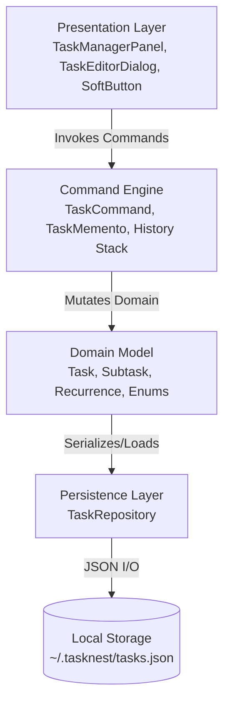

# TaskNest — Java Task Management System

[](https://openjdk.org/)
[](https://docs.oracle.com/en/java/javase/21/docs/api/java.desktop/javax/swing/package-summary.html)
[](#software-architecture--design-patterns)
[](#authors--submission-details)
[-brightgreen)](#quick-start--execution)

TaskNest is a modern Java Swing desktop TODO and productivity management application designed and developed for the **Software Construction Open-Ended Lab (OEL)**. The system provides complete task lifecycle management with responsive controls, robust input validation, and a custom design palette blending textured cream canvas with soft slate-blue accents.

---

## Authors & Submission Details

- **Student 1 (Author):** Muhammad Mehroz Ammar (Registration No: `534699`) — [@Mehroz485](https://github.com/Mehroz485)
- **Student 2 (Partner):** Ashir Hamid — [@ashirhamid](https://github.com/ashirhamid)
- **Course / Lab:** Software Construction — Open-Ended Lab (OEL)
- **Course Rubric Mapping:** 30C Evaluation Rubric (Total: 30 Marks)
- **GitHub Repository:** [`https://github.com/ashirhamid/TodoList.git`](https://github.com/ashirhamid/TodoList.git)
- **Active Branch:** `main`

---

## Course Learning Outcomes (CLO) Alignment

| CLO | PLO | Level | Learning Outcome | Weight | Application Evidence |
| :--- | :--- | :--- | :--- | :--- | :--- |
| **CLO-4** | PLO-5 | P-3 | Practice and adapt modern tools for software construction. | **25%** | Project built using OpenJDK 21 LTS, Git CLI, GitHub remote collaboration, JDK Javadoc generation, and Windows batch automation scripts. |
| **CLO-5** | PLO-5 | P-4 | Execute a software construction workflow independently producing a working application with recorded revisions and generated code documentation. | **75%** | Complete Java Swing CRUD application adhering to SOLID principles and GoF patterns (Command, Memento, Composite, Repository), 11 granular Git commits, full Javadoc API docs, and 20 verified test cases. |

---

## Key Features

### 1. Core Task Management (CLO-5 Baseline)
- **Full CRUD Operations:** Create, view, update, and delete tasks with instant UI updates.
- **Taxonomy & Metadata:** Assign Titles, detailed Descriptions, Categories (*Work, Study, Personal, Fitness, Errand*), Priorities (*Urgent, High, Medium, Low*), and Due Dates.
- **Operational Status Tracking:** Track tasks through *Pending*, *In Progress*, and *Completed* states with visual cue changes (strikethrough and color-coded badges).
- **Strict Input Validation:** Empty or whitespace-only titles are blocked with informative validation dialogs (`Title required`). Non-existing tasks and corrupted inputs are handled gracefully without crashing.

### 2. Extended Productivity Features (Above Baseline)
- **🔴 Smart Due-Date Badges & Urgency Filters:**
  - Real-time comparison against `LocalDate.now()` dynamically tags tasks with badges:
    - 🔴 **Overdue:** Due date is in the past and task is pending.
    - 🟡 **Due Today:** Due date matches today's date.
    - 🟢 **Upcoming:** Due date is within the next 3 days.
  - Dedicated sidebar filter pills (*"Due Today"* and *"Overdue"*) allow one-click isolation of critical deliverables.
- **📊 Live Productivity Progress Bar & Summary Stats:**
  - Dynamic dashboard card above the task list computing real-time completion percentage (e.g., `67% completed · 6 of 9 tasks`).
  - Real-time aggregation of active vs. completed tasks, overdue counts, and subtask statistics using Java Streams.
- **📁 One-Click Markdown Checklist & CSV Export:**
  - **Markdown (`.md`):** Exports formatted checklists (`- [x] Done`, `- [ ] Pending`) ready for GitHub, Notion, or Obsidian.
  - **Spreadsheet (`.csv`):** Exports clean tabular data opening directly in Microsoft Excel and Google Sheets.
- **☑️ Sub-Tasks Micro-Checklists (Composite Pattern & Two-Way Sync):**
  - Nested sub-task checklists rendered directly on task cards.
  - **Bidirectional Synchronization:** Ticking the parent task auto-completes all subtasks; ticking all subtasks auto-promotes the parent task to Completed; unchecking any subtask reverts the parent to Pending.
- **🔁 Smart Recurring Tasks Engine:**
  - Configurable repeat intervals (*Daily, Weekly, Monthly*).
  - Automatically calculates and schedules the next occurrence date (`dueDate.plusDays(1)`, `plusWeeks(1)`, `plusMonths(1)`) upon task completion while preserving the completed record.
- **↩️ Undo / Redo Command History with Interactive Toast UI:**
  - Full multi-level history stack implementing the Gang of Four Command & Memento patterns.
  - Supports global keyboard shortcuts (`Ctrl+Z` / `Ctrl+Y`) and an interactive notification toast with a clickable **"Undo"** action.

---

## Software Architecture & Design Patterns

TaskNest strictly follows SOLID principles and Gang of Four (GoF) design patterns:



- **Model-View-Controller (MVC):** Strict decoupling between presentation components (`TaskManagerPanel`, `ColorWashPanel`), domain entities (`Task`, `Subtask`), and data persistence (`TaskRepository`).
- **Command Pattern (`TaskCommand`):** Encapsulates task mutations (`AddTaskCommand`, `DeleteTaskCommand`, `UpdateTaskCommand`, `ToggleTaskCommand`, `ToggleSubtaskCommand`) with bidirectional `execute()` and `undo()` operations.
- **Memento Pattern (`TaskMemento`):** Captures immutable state snapshots before destructive operations, allowing atomic rollback without exposing internal structure.
- **Composite Pattern (`Task` & `Subtask`):** Treats individual checklist items and parent task containers uniformly for recursive status synchronization.
- **Repository Pattern (`TaskRepository`):** Encapsulates local JSON storage, thread-safe mutations, atomic saving, and graceful error handling.

---

## Quick Start & Execution

### Prerequisites
- **JDK 17 or newer** (tested on **OpenJDK 21 LTS**)
- Windows 10/11, macOS, or Linux

### Running on Windows
1. **One-Click Batch Launcher (Recommended):**
   Simply double-click [`run.bat`](file:///run.bat) or run from PowerShell:
   ```cmd
   .\run.bat
   ```
   *The launcher automatically detects OpenJDK 21 at `E:\DevTools\jdk-21`, falls back to system `java`, compiles source files, and launches the desktop app.*

2. **Pre-Built Executable JAR:**
   ```powershell
   java -jar dist\TaskNest.jar
   ```

3. **PowerShell Script:**
   ```powershell
   .\run.ps1
   ```

4. **IDE Import:**
   Open the folder in IntelliJ IDEA, Eclipse, or NetBeans, mark `src/main/java` as Sources Root, and run `edu.oel.tasknest.TaskNestApp`.

---

## Generating Javadoc Documentation

Generate clean HTML API documentation with the JDK Javadoc tool:

```powershell
.\generate-javadoc.ps1
```

The generated documentation is located at [`docs/javadoc/index.html`](docs/javadoc/index.html) and features searchable indexes for all classes, methods, and package trees.

---

## Project Structure

```text
TodoList/
├── dist/
│   └── TaskNest.jar              # Executable standalone JAR package
├── docs/
│   ├── javadoc/                  # Complete generated HTML Javadoc tree
│   ├── OEL_Report.md             # Markdown OEL comprehensive report
│   ├── requirements-and-design.md# Software Requirements & Specification
│   └── TaskNest_Final_OEL_Report_30C.docx # Official Word report (30C rubric)
├── src/
│   └── main/
│       └── java/
│           └── edu/
│               └── oel/
│                   └── tasknest/
│                       ├── Category.java           # Named category taxonomy enum
│                       ├── ColorWashPanel.java     # Custom gradient/wash background UI
│                       ├── Priority.java           # Task priority enum (Urgent, High, Med, Low)
│                       ├── Recurrence.java         # Daily/Weekly/Monthly recurrence engine
│                       ├── SoftButton.java         # Custom styled rounded button component
│                       ├── Subtask.java            # Child checklist composite model
│                       ├── Task.java               # Core Task entity model & validation
│                       ├── TaskCommand.java        # GoF Command & Memento undo/redo engine
│                       ├── TaskEditorDialog.java   # Input modal with strict validation
│                       ├── TaskManagerPanel.java   # Main dashboard, filters, list & toast UI
│                       ├── TaskNestApp.java        # Main application bootstrap
│                       ├── TaskRepository.java     # JSON persistence repository
│                       └── TaskStatus.java         # Status enum (Pending, In Progress, Done)
├── .gitignore                    # Git ignore file (build artifacts, IDE configs)
├── generate-javadoc.ps1          # Javadoc generation automation script
├── README.md                     # Project documentation & overview
├── run.bat                       # Windows one-click desktop batch launcher
└── run.ps1                       # Windows PowerShell build & launch script
```

---

## Verification & Test Results (CLO-5)

A comprehensive test suite of 20 test cases was executed on November 22, 2026. All 20 tests passed successfully (100% Pass Rate):

| Test ID | Test Description | Expected Result | Actual Result | Status |
| :--- | :--- | :--- | :--- | :---: |
| **TC-01** | Add a valid task | Task is added to repository and rendered in list | Task displayed with category, priority, and status; count = 1 | **PASS** |
| **TC-02** | Add task with empty title | Validation message displayed; submission blocked | Warning dialog displayed: *"Title required"* | **PASS** |
| **TC-03** | View all tasks | Multiple tasks displayed in list | All tasks rendered; open task counter updates | **PASS** |
| **TC-04** | Empty search result | Appropriate empty state message displayed | *"Nothing to show here. Try a different search or filter."* | **PASS** |
| **TC-05** | Update an existing task | Changes persisted and updated in UI | Task card reflects edited title and description immediately | **PASS** |
| **TC-06** | Mark task completed | Checkbox strikes title; counter updates | Title struck through; status badge updates to Completed | **PASS** |
| **TC-07** | Delete an existing task | Task removed after confirmation | Confirmation shown; task removed; Undo toast appears | **PASS** |
| **TC-08** | Filter by High Priority | Only high priority tasks shown | Filtered list displayed with dedicated progress indicator | **PASS** |
| **TC-09** | Change status to In Progress | Status badge updates to In Progress | Status badge updates from Pending to In Progress | **PASS** |
| **TC-10** | Set status to Completed | Status badge updates; progress bar hits 100% | Completed badge shown; progress bar reaches 100% | **PASS** |
| **TC-11** | Overdue due-date badge | Red `🔴 Overdue` badge rendered | `🔴 Overdue` pill displayed; urgency counter shows 1 overdue | **PASS** |
| **TC-12** | Due Today badge | Amber `🟡 Due Today` badge rendered | `🟡 Due Today` pill displayed; urgency counter updates | **PASS** |
| **TC-13** | Upcoming due-date badge | Green `🟢 Upcoming` badge rendered | `🟢 Upcoming` pill displayed next to due date | **PASS** |
| **TC-14** | Live productivity progress bar | Dynamic completion % recalculates | Progress bar updates dynamically on any task mutation | **PASS** |
| **TC-15** | Export format selector | Dialog offers Markdown (.md) and CSV (.csv) | Format selector modal opens with clean option buttons | **PASS** |
| **TC-16** | CSV file save dialog | Native file chooser opens with default filename | File chooser pre-populates `TaskNest-Tasks-YYYY-MM-DD.csv` | **PASS** |
| **TC-17** | Sub-tasks micro-checklist | Subtasks render with interactive checkboxes | Checkboxes render on card; badge updates to green `3/3 subtasks` | **PASS** |
| **TC-18** | Recurring task auto-schedule | Completing task schedules next occurrence | Toast confirms next date scheduled; completed task archived | **PASS** |
| **TC-19** | Deletion confirmation & toast | Confirmation prompt shown; toast appears | Task removed; toast notification banner appears with Undo button | **PASS** |
| **TC-20** | Undo task deletion | Clicking Undo restores deleted task | Task restored with all original metadata and badges intact | **PASS** |

---

## Git Version Control History

The project repository records 11 granular, meaningful commits:

```text
19822bf docs: add comprehensive OEL evaluation report covering CLO-4 and CLO-5
90fa01d docs: update SRS architecture document, Javadoc API reference, and release JAR
3087aae feat(ui): add urgency badges, live productivity progress bar, filters, and export
c6020fe feat(persistence): integrate subtasks, recurrence, and JSON serialization in TaskRepository
b50e3bd feat(history): implement Undo/Redo architecture using GoF Command Pattern and Memento
f922adf feat(subtasks): implement subtask hierarchy with bidirectional completion sync
fbab426 feat(recurring): implement recurrence schedule engine (Daily, Weekly, Monthly)
b1027e5 refactor(meta): update author metadata to Muhammad Mehroz Ammar (534699) and Ashir Hamid
82e98d7 chore: add Windows batch launcher script with JDK auto-detection
f61bc5b Add TaskNest Java task manager
883d71c Initial commit
```

---

## Submission Deliverables

- **GCR Upload 1:** Complete OEL Report in PDF format (`TaskNest_Final_OEL_Report_30C.pdf`).
- **GCR Upload 2:** Complete project source code in ZIP format (`TaskNest_OEL_Submission_534699.zip`).
- **GitHub Repository:** [`https://github.com/ashirhamid/TodoList`](https://github.com/ashirhamid/TodoList) (`main` branch).
- **Physical Viva & Checking:** Commencing November 23, 2026.
